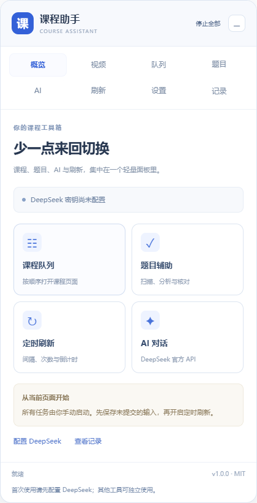

# 课程助手

一个独立实现的轻量用户脚本，将课程队列、视频控制、题目辅助、DeepSeek 对话和定时刷新放进同一个面板。**MIT 许可，安装一个文件，无运行时外部脚本依赖。**

[安装脚本](https://raw.githubusercontent.com/CrystalXHorizon/course-assistant/main/course-assistant.user.js) · [下载发布版](https://github.com/CrystalXHorizon/course-assistant/releases/latest) · [反馈问题](https://github.com/CrystalXHorizon/course-assistant/issues)



## 安装

1. 在浏览器中安装 [Tampermonkey](https://www.tampermonkey.net/) 或支持相同 GM 接口的脚本管理器。
2. 点击上方安装链接，按扩展提示安装。也可以新建脚本，粘贴 `course-assistant.user.js` 的完整内容并保存。
3. 打开学习通或智慧树网页，右下角出现“课程助手”。若没有出现，检查扩展的站点访问权限及用户脚本运行权限。
4. 需要 AI 功能时，在“设置”填写自己的 DeepSeek API Key，保存后测试连接。

**从旧版迁移：** 先停用原 ABC 或其他重复课程辅助、刷新脚本。这个版本使用独立存储，不读取或迁移旧脚本的密钥与设置。

## 功能

| 功能 | 当前行为 |
| --- | --- |
| 定时刷新 | 10 秒～24 小时，快捷间隔、倒计时、次数上限；正常刷新后继续，改变网址后暂停 |
| 视频控制 | 检测当前页面及可访问同源框架中的 HTML5 视频；播放、暂停、从头开始、0.5～2 倍速和当前视频循环 |
| 课程队列 | 手动加入同站链接，在当前标签页顺序打开；暂停、下一项、整个队列循环 |
| 视频结束衔接 | 本次队列运行中所有可见视频自然结束后前往下一项；不能识别的页面由用户手动前进 |
| 题目扫描 | 识别语义明确容器中的标准单选、多选、文本框题目，支持可访问同源框架 |
| 题目分析 | 单题或批量调用 DeepSeek，解析结构化答案；可手动填入，或显式开启分析后填入；不自动提交 |
| 题目搜索 | 按关键词过滤本次扫描到的题目 |
| AI 对话 | 官方 DeepSeek API、上下文、停止请求、清空对话；回答完成后一次显示 |
| 复制粘贴 | 可选的文本选中、复制、剪切、粘贴与右键限制解除；保留浏览器默认操作 |
| 运行记录 | 本地日志、答题记录、分别清空；错误消息不显示 API 响应正文或密钥 |
| 界面 | 八个功能页、拖动、收起、窄窗口适配、键盘焦点与停止全部 |

## 适用范围与限制

- 自动匹配 `chaoxing.com`、`xuexi365.com`、`zhihuishu.com` 及其子域名。**匹配域名不代表该平台所有页面都已适配。**
- 本项目从头实现功能，未包含旧第三方脚本的实现、私有题库协议、平台内部提交接口或课程记录修改逻辑，**不是旧版所有功能的等价替代**。第三方付费题库、自动交卷、强制绕过播放器限制等不在本版本中。
- 题目识别基于可见的原生输入控件及 `fieldset`、`data-question`、常见 question 容器。图片题、封闭 Shadow DOM、特殊自定义选项和跨域框架可能无法识别；请使用 AI 页手工输入或自行操作。
- 跨域 iframe 和非 HTML5 播放器不受控制。速度能否生效取决于播放器。不能保证平台接受倍速或记录课程进度。
- 队列仅支持同源网址。它保存在当前标签页的会话存储中；无法跨站衔接，也不代表课程、测验已完成。多个视频可同时开始播放；没有视频的页面需手动前进。
- 刷新会丢失未保存输入，中断播放与请求。后台冻结、休眠、断网或关闭浏览器都会影响计时；不会补发积压的刷新。它不保证延长登录状态。
- AI 答案可能出错，填入后需自行核对。未明确匹配的答案会报错，不猜测选项。

## 数据与网络

- 不包含 API Key、账号、Cookie、遥测或第三方题库。
- API Key 和设置保存在脚本管理器的本地存储里；它不是系统密钥保险库。保存后立即清空密钥输入框，之后不会将已存密钥回填到网页；留空保存会保留原密钥，也可显式清除。密钥输入界面仍运行在网页中，请仅在可信页面配置。
- 用户主动使用 AI 时，输入的聊天内容或扫描题干与选项会发送到 `https://api.deepseek.com`；可能产生账户费用。其他页面内容不会自动发送。
- 连接测试只请求 `/models`；对话与题目分析请求 `/chat/completions`。密钥通过请求头发送，不进入日志或请求 URL。
- 聊天记录只保留在页面内存中。答题记录和日志在扩展本地保存，分别最多 100 和 150 条。
- 定时刷新和队列保存在当前标签页的 `sessionStorage`。关闭页面、浏览器恢复标签页的具体行为可能不同。
- 脚本管理器可能按自身设置请求 GitHub 上的更新文件；用户脚本运行时不加载外部 JavaScript、字体或图片。

接口参考：[DeepSeek Chat Completions](https://api-docs.deepseek.com/api/create-chat-completion/)、[模型列表](https://api-docs.deepseek.com/api/list-models/)、[Tampermonkey 文档](https://www.tampermonkey.net/documentation.php)。默认模型可在设置中修改，也可通过“测试连接 / 获取模型”核对账户可用模型。

## 开发与验证

需要 Node.js 20 或更新版本。

```sh
npm ci
npx playwright install chromium
npm run check
```

Linux CI 安装浏览器时使用 `npx playwright install --with-deps chromium`。Windows 测试优先使用已安装的 Edge；也可通过 `PLAYWRIGHT_BROWSER_PATH` 指定浏览器。

```text
src/core.cjs         纯逻辑：定时器、答案映射、API 请求和队列状态
src/dom.cjs          页面扫描、表单填入与复制粘贴
src/app.js           面板、视频、队列、AI 和交互状态
src/style.css        独立样式
scripts/build.cjs   打包为单文件用户脚本
tests/              核心和真实浏览器模拟页面测试
```

`npm run build` 会更新根目录的 `course-assistant.user.js`，产物一并提交，方便直接安装。测试不连接真实学习通账号，不调用收费 API，使用合成题目、模拟播放器与模拟 GM 请求。

当前版本通过 16 项核心测试及 11 项浏览器测试，包括倒计时恢复、刷新限次、API 取消、选项去重、填入验证、跨页签状态、窄屏、复制开关和密钥不回填。**未在登录后的真实课程或真实 DeepSeek 账户上验收。** 截图来自模拟页面。

## 许可

[MIT](LICENSE) © 2026 CrystalXHorizon。本仓库源码和打包脚本为独立实现。开发时使用的 Playwright 仅为测试依赖，不打包进用户脚本，并按其自身许可分发。
